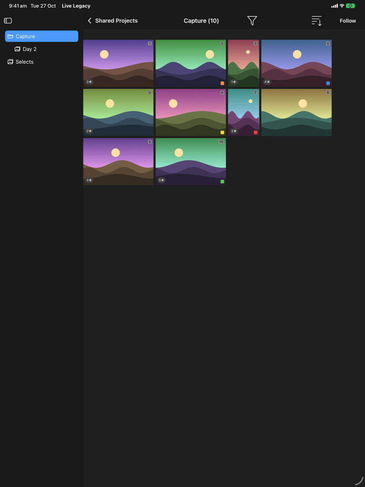
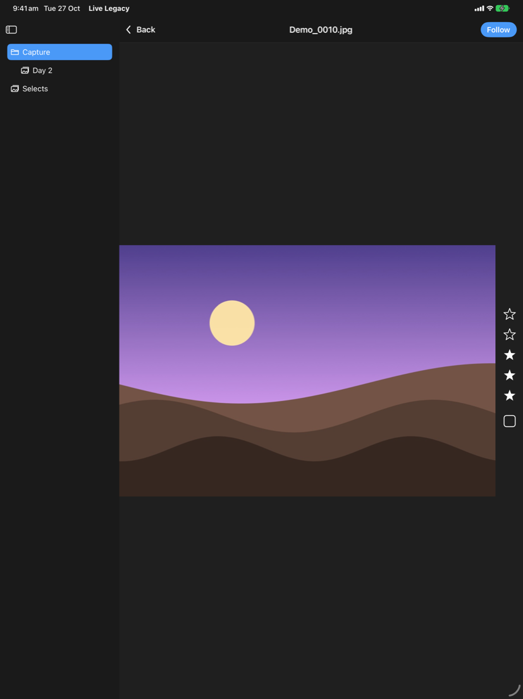
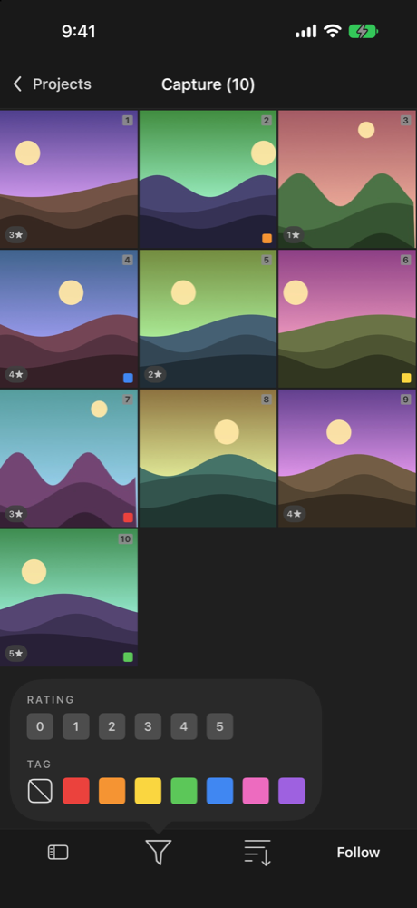
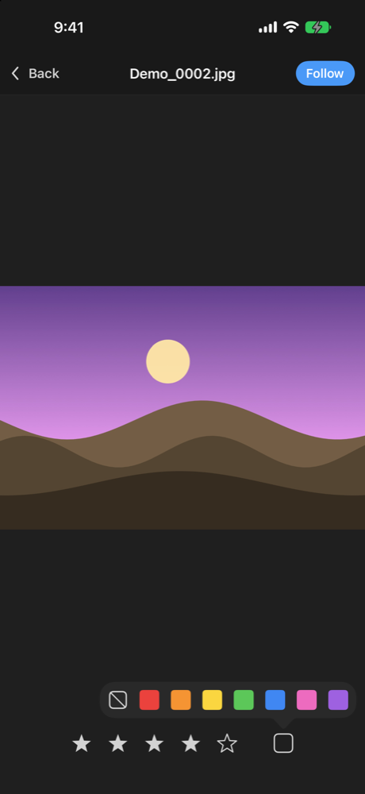

# LiveLegacy

A viewer for Capture One's **Live for Studio** that runs on old iPads and iPhones. It needs iOS 12 or later.

Capture One's own Live app needs iPadOS 16. That leaves out a lot of iPads that are still perfectly good for a
client or art director to hold during a shoot, like the iPad mini 2, iPad Air 1 and iPad mini 3. LiveLegacy talks to
the same Live for Studio share from the desktop, so those iPads can browse, rate, tag and follow captures again.

It also runs on iPhone and iPod touch (the official app is iPad only), including old ones stuck on iOS 12 like the
iPhone 5s, iPhone 6 and iPod touch 6th gen. The phone version has its own layout: the folders slide in from the left,
filter, sort and Follow sit in a bar along the bottom, and the stars run across the bottom of the viewer.

This is an unofficial project. It has nothing to do with Capture One and isn't supported by them.

<p>
  
  
  
</p>
<p>
  
</p>

## What it does

- Finds shared sessions on your network by itself, or you can type in the IP and port.
- Shows a sidebar of the shared folders and collections, with subfolders nested like they are on the desktop.
- Shows a thumbnail grid, sorted by Last Captured either way round.
- Filters by star rating and colour tag.
- Has a full-screen viewer. Pinch or double-tap to zoom (it fetches a sharp crop of whatever you're zoomed into), and
  swipe to move between images.
- Lets you set the star rating and colour tag. They go straight back to Capture One, and changes made on the desktop
  show up live.
- Has Follow, which jumps to every new capture as it comes in. Capture One's **Trigger Follow** button turns it on
  remotely.
- Supports keyboard shortcuts if you've got a keyboard attached: arrow keys to move, `0`–`5` to rate, `⌥0`–`⌥7` to
  tag, `F` to follow and `Esc` to go back.
- Has two settings: Prevent Sleep and Follow Border.

It looks and works like the official app, so anyone who's used that won't need showing.

## What you need

- **Capture One Studio** on a Mac, with the Live for Studio tool. I've tested it with 16.8.6.
- An iPad, iPhone or iPod touch on **iOS 12 or newer** on the same network as the Mac. I've tested it on an iPad
  mini 2 running iOS 12.5.8, and the phone layout in the simulator. It needs a 64-bit device, which covers
  everything that can run iOS 12.

## Installing it

It isn't on the App Store (see [why](#why-isnt-it-on-the-app-store)), so you sideload it. You do this once per device.

1. Download `LiveLegacy-unsigned.ipa` from the [latest release](../../releases/latest).
2. Install [Sideloadly](https://sideloadly.io) on your Mac or PC. (AltStore won't do it: current versions need
   iOS 14 or later.)
3. Plug the device in with a cable and tap **Trust** on it if it asks.
4. Open Sideloadly, drag the IPA in, type in your Apple ID and hit **Start**. Sideloadly signs the app with your
   Apple ID and installs it.
5. The first time you open it, iOS may say the developer isn't trusted. Go to **Settings → General → Profiles &
   Device Management**, tap your Apple ID and trust it.

How long it keeps working depends on the Apple ID:

- **Free Apple ID:** the app stops opening after **7 days**. Plug in and run Sideloadly again to refresh it. Your
  saved servers and settings aren't lost.
- **Paid Apple Developer account** (A$149 a year): it lasts a year.

## Using it

1. In Capture One, open your session and go to the **Tether** tab. In the **Live for Studio** tool, pick what to
   share and click **Start Sharing**.
2. Open LiveLegacy on the iPad or iPhone. The session shows up under **Shared** after a second or two. Tap it.
   No Capture One handy? Tap **Demo Project** to try the app with built-in sample images.
3. If it doesn't show up, Bonjour discovery is probably being blocked. Guest Wi-Fi and some office networks do this.
   Tap the screen icon at the top right and enter the IP address and port. You'll find both under **⋯ → Network
   Settings** in the Live for Studio tool. The port changes every time you start sharing, so check it again if you
   stop and start.

When you click Stop Sharing on the Mac, the app tells you the project is no longer shared and goes back to the
list.

## Things to know

- **Passwords:** a share with a password set probably won't connect. I haven't been able to test it yet. Leave the
  password blank for now.
- **Network:** both devices need to be on the same network. Phone hotspots tend to be flaky, and so are VPNs.
- **Filter:** you can pick several ratings and tags at once. An image shows if it matches any of them.

## Why isn't it on the App Store?

Two reasons:

- Apple only accepts uploads built with the current Xcode, and the current Xcode can't build for anything older than
  iOS 15. The whole point of this app is iOS 12, so the App Store route is out.
- It's an unofficial client for someone else's product, which App Review generally doesn't like.

## Building it yourself

You need a Mac with Xcode installed. Xcode won't build for iOS 12 any more (its lowest target is iOS 15), but the
Swift compiler it ships still makes a working iOS 12 app. `build.sh` calls the compiler directly and skips Xcode's
check.

```bash
./build.sh unsigned   # build/LiveLegacy-unsigned.ipa, for sideloading
./build.sh sim        # build/sim/LiveLegacy.app, for a current iPad or iPhone simulator
TEAM_ID=... ./build.sh appstore   # iOS 15+ App Store build via xcodebuild (needs a release Xcode)
PROFILE=path/to/profile.mobileprovision ./build.sh   # signed with your own developer profile
```

If you've got a paid developer account and the device is registered on it, a signed build can go straight on with
[libimobiledevice](https://libimobiledevice.org):

```bash
brew install ideviceinstaller
ideviceinstaller install build/LiveLegacy.ipa
```

Your own profile has to include the device. Xcode can't see iOS 12 devices any more, so add its UDID yourself
at [developer.apple.com](https://developer.apple.com/account/resources/devices/list). Running `idevice_id -l` with the
device plugged in prints it.

The code is plain UIKit with no dependencies. `project.yml` is there if you want an Xcode project for reading and
editing (`xcodegen`). Just don't expect Xcode to build it for an iOS 12 device.

## How it works

Live for Studio is plain HTTP on your local network. Capture One advertises the share over Bonjour as `_http._tcp`,
with `platform=Capture One Mac` in its TXT record. The app then:

1. Shakes hands with `getProtocolVersionForLive` and `connectToServiceForLive`, which hands back a session ID.
2. Loads the folders and images with `getServerStateForLive`.
3. Keeps a long-poll open on `getServerChangesForLive`. That's how new captures, rating changes and Trigger Follow
   arrive.
4. Pulls thumbnails, full images and zoomed crops from `getImageForLive`.
5. Writes ratings and tags back with `setPropertyForLive`.

All of it lives in [`LiveClient.swift`](LiveLegacy/LiveClient.swift) if you're curious.

## License

MIT. See [LICENSE](LICENSE). Capture One and Live for Studio are trademarks of Capture One A/S. This project just
talks to them over your network.
